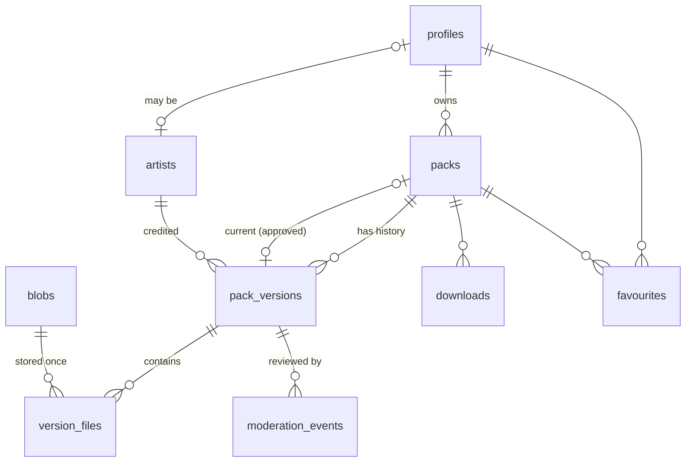

# Wallpy data model (draft v1)

Status: **proposal, not applied.** Replaces the schema reconstructed in
`supabase/migrations/20251212000000_baseline.sql`.

## Why redesign

Everything that went wrong in the first version traces back to four gaps:

| Problem we hit | Root cause | Fix in this design |
|---|---|---|
| Three different zip layouts; CLI installs a broken pack called `images` | No written pack format; site and CLI each assumed one | One JSON Schema in `spec/` that both the site (JS) and CLI (Python) validate against |
| Site publishes `album` packs the CLI can't read | Same | `album` added to the spec *and* the CLI |
| Uploader could overwrite any pack's files | Storage keys chosen by the client | Keys derived from file content (SHA-256), pinned in the presigned URL |
| Approved pack could be silently swapped | Pack row holds mutable file URLs | Content lives in immutable **versions**; edits create a new version that goes through review |
| Renamed pack broke its files (`zelda-wind-waker` vs `-walker`) | Storage keys contained the slug | Keys never contain names |
| Downloads/moderation could be faked or lost | Mutable counters/columns | Append-only `downloads` and `moderation_events` tables |
| Third-party art had no credit field (ArseniXC, Matt Vince) | Only a free-text `author_name` | `artists` table |

## Entities



### `profiles` (was `users`)
Public profile, 1:1 with `auth.users`. Renamed because `users` invites
confusion with `auth.users`, and **email is no longer copied here at all**:
it lives only in `auth.users`, so it can't leak through this table.

| column | type | notes |
|---|---|---|
| id | uuid PK → auth.users | |
| username | citext unique | `^[a-z0-9_]{3,30}$` |
| display_name, bio | text | length-checked (`website` was moved into `links` and dropped, 2026-10-17) |
| links | jsonb | array of `{label, url}`, `http(s)` only (check constraint) |
| contact_email | text null | optional *public* contact address, opt-in |
| avatar_key, cover_key | text null | R2 keys, see Storage |
| role | enum `user \| moderator \| admin` | not user-editable |
| created_at, updated_at | timestamptz | |

### `artists`
Who made the art, separate from who uploaded it. Lets packs share a credit
("more by ArseniXC") and lets an artist later claim it with an account.

| column | type | notes |
|---|---|---|
| id | uuid PK | |
| name | text | |
| url | text null | portfolio / source |
| avatar_key | text null | the old site already had `public/artists/*` |
| profile_id | uuid null → profiles | set when the artist has an account |

### `packs`
Stable identity only. Nothing here describes content, so nothing here needs review.

| column | type | notes |
|---|---|---|
| id | uuid PK | |
| slug | citext unique | URL + `wallpy download <slug>`; never used in storage keys |
| owner_id | uuid → profiles, nullable | null: the owner deleted their account and kept the pack up ("Deleted user") |
| current_version_id | uuid null → pack_versions | latest **approved** version; null = never approved |
| is_listed | bool default true | owner can hide it from the gallery, search and their profile; the link and installs keep working |
| removed_at, removed_reason | | moderator takedown |
| download_count, favourite_count | int | cached, maintained by triggers |
| created_at | | |

A pack is publicly visible iff `current_version_id is not null and removed_at is null`; `is_listed` only decides whether listings show it (site queries filter on it). Owners can `withdraw_version()` a pending version (back to draft) and `delete_my_account(keep_published)`.

### `pack_versions`
An immutable snapshot of a pack's content + metadata. Editing a pack = creating
version N+1; version N stays live until N+1 is approved.

| column | type | notes |
|---|---|---|
| id | uuid PK | |
| pack_id | uuid → packs | |
| number | int | 1, 2, 3… unique per pack |
| status | enum `draft \| pending \| approved \| rejected \| superseded` | changed only via `moderate()` |
| title, description | text | here (not on `packs`) so title edits are reviewed too |
| tags | text[] | lowercase, ≤ 10 |
| kind | enum `timeblocks \| days \| album` | **generated** from the schedule (`schedule_kind()`), so it can't disagree with it; UI labels Daypack / Weekpack / Album |
| ai_use | enum `none \| assisted \| generated`, null | how AI was used; required to submit; shown as a label beside the details, never in the credit line |
| schedule | jsonb | spec 2, validated against `spec/schedule.schema.json` (structure checked by `schedule_ok()`); **the zip's `schedule.toml` is generated from this**, never stored separately |
| cover_file_id | uuid → version_files | which image represents the pack |
| artist_id | uuid null → artists | |
| uploader_is_artist | bool | |
| license | enum, default `personal-use` | see Decisions |
| license_notes | text null | |
| created_by, created_at, submitted_at | | |

### `blobs`
Every stored file, keyed by its SHA-256. An image shared by v1 and v2 (or by
two packs) is stored once.

| column | type | notes |
|---|---|---|
| sha256 | text PK | hex |
| size, mime, width, height, blurhash | | measured on upload |
| uploaded_by | uuid → profiles | |
| created_at | | |

### `version_files`
Which blobs make up a version, under which filename.

| column | type | notes |
|---|---|---|
| id | uuid PK | |
| version_id | uuid → pack_versions | |
| path | text | e.g. `dawn1.jpg`, exactly as referenced in `schedule` |
| sha256 | text → blobs | |
| sort_order | int | |
| unique (version_id, path) | | |

| thumb_sha256, preview_sha256 | text null | this file's 640px / 1920px WebP renditions (blobs; no FK, trigger-checked, see decisions) |

The version itself also has `thumb_sha256`/`preview_sha256`: its cover's
renditions, for gallery cards. So neither the gallery nor the pack page ships
4K originals; the CLI and ZIP still get the originals.

### `moderation_events` (append-only)
`id, version_id, actor_id, action (submit|approve|reject|takedown|restore), notes, created_at`.
The only way to change a version's status is `moderate(version_id, action, notes)`,
a `security definer` function that checks the actor's role, writes the event, and
updates `pack_versions.status` / `packs.current_version_id` in one transaction.
The log is the source of truth; `status` is a cache of it.

### `downloads` (append-only)
`id bigint, pack_id, version_id, profile_id null, client (cli|web), ip_hash, created_at`.
Inserted only by the download endpoint (service role). `ip_hash` is
`sha256(ip || daily_salt)`: enough to dedupe repeat downloads within a day,
useless for tracking anyone. Raw IPs are never stored.

### `favourites`
`(profile_id, pack_id) PK, created_at`. Lists private to the owner; counts public.

## Storage (Cloudflare R2)

| bucket | key | contents |
|---|---|---|
| `wallpy-public` (custom domain, CDN) | `blobs/<sha256>` | pack images + thumbnails |
| | `profiles/<user_id>/<sha256>.<ext>` | avatars, covers |
| `wallpy-packs` (private) | `archive/…`, `recovered/…` | backups only |

**Upload flow.** The browser hashes each file, asks
`POST /api/uploads` for presigned URLs, and the server signs a PUT to
`blobs/<sha256>` that pins the SHA-256, content type and size. R2 rejects
anything else (verified: tampered bytes → `BadDigest`, other content type or
missing checksum → `SignatureDoesNotMatch`). The client can't choose a key, so it
can't overwrite anything; and if the blob already exists, the upload is skipped.

**Why public-with-hashed-keys instead of private + signed URLs.** A SHA-256 can't
be guessed without already having the file, so pending uploads aren't
discoverable, while approved images get CDN caching and free egress. Rejected or
taken-down content is deleted by a cleanup job once no approved version
references it. *Trade-off:* someone who already has a pending image's URL keeps
access until that cleanup runs.

## What the CLI downloads

No stored zips. `GET /api/packs/<slug>/manifest` returns:

```json
{
  "slug": "zelda-wind-waker", "version": 3,
  "schedule": { "...": "same JSON as pack_versions.schedule" },
  "files": [{ "path": "dawn1.jpg", "sha256": "…", "size": 4349123,
              "url": "https://files.…/blobs/…" }]
}
```

The CLI writes `schedule.toml` + `images/`, verifying every file's hash. One
format, no zip layout to get wrong, resumable, and storage isn't doubled (today
every pack is stored twice: loose images + zip). The website's "Download ZIP"
button builds the zip **in the browser** from the same manifest.

## The shared spec

`spec/schedule.schema.json` (JSON Schema) defines all three kinds:

```toml
[meta]   # name, author, description, version, type = timeblocks | days | album
[timeblocks.<name>]  start, end ("08:30" | "sunrise+30m"), images, shuffle
[days.<weekday>]     images, shuffle
[album]              images, shuffle, interval = "30m"   # new
```

Used by: site upload form (ajv), `/api/uploads/submit` (server-side, authoritative),
a Postgres check on `pack_versions.schedule`, and the CLI validator (`jsonschema`).
Album rotation in the CLI is stateless (the service runs every few seconds):
`images[floor(now / interval) % n]`, with shuffle as a per-cycle seeded permutation.

## Migrating the current data

| today | becomes |
|---|---|
| 3 `users` rows | 3 `profiles` (avatars from `_src/recovered/avatars`) |
| 4 `packs` | 4 packs × v1, schedules from `spec/examples/` |
| Tokyo Street / Zelda credits | `artists`: ArseniXC, Matt Vince |
| Greasy Diner | **needs a schedule**; stays `draft` until it has one |
| 0 favourites, 0 downloads | empty tables |

## Decisions (2026-10-16)

1. **Images**: public bucket with SHA-256 keys + CDN.
2. **Album interval**: `"<n>m|h|d"`, 5m to 7d; the UI offers presets (15m, 30m, 1h, 6h, 1d).
3. **Favourites**: private to the owner; only counts are public.
4. **Licence**: enum `personal-use` (default) | `cc-by-4.0` | `cc-by-nc-4.0` | `cc0` | `other`, plus optional `license_notes`.
5. **Greasy Diner**: schedule written from its filenames (`spec/examples/greasy-diner.schedule.toml`); artist unknown, so it ships with no credit until confirmed.
